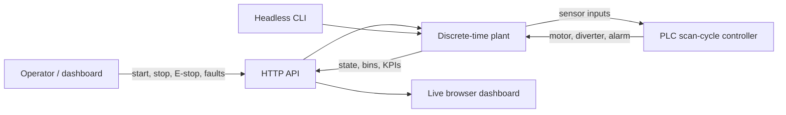

# Sorter Lab

[中文说明](README.zh-CN.md)

**A small, reproducible digital twin for learning PLC-controlled material handling.**

Sorter Lab models a two-product conveyor sorting station as a discrete-time process. A PLC-style controller reads photoeyes, runs a scan-cycle state machine, schedules a diverter pulse, and applies latched safety and fault behavior. A browser dashboard makes the I/O and process visible; a headless CLI makes experiments repeatable.

> Educational simulator only. It is not a safety controller, a validated digital twin, or a replacement for a physical risk assessment. Do not connect it to real machinery.

## See it run

```console
git clone https://github.com/Hmhhhh/sorter-lab.git
cd sorter-lab
python -m venv .venv
# Windows: .venv\Scripts\activate
# macOS/Linux: source .venv/bin/activate
python -m pip install -e .
sorter-lab web
```

Open [http://127.0.0.1:8765](http://127.0.0.1:8765), press **Start**, and inject a sensor, jam, or diverter fault. The server binds to localhost by default.

Run a reproducible headless experiment:

```console
sorter-lab simulate --seconds 60 --seed 7
sorter-lab simulate --seconds 60 --seed 7 --fault diverter_failure --fault-at 20
sorter-lab simulate --seconds 120 --csv run.csv
python -m unittest discover -s tests -v
```

No runtime dependencies beyond Python 3.11+ are required. For development without installing the package, run tests from the repository root.

## What is modeled

| Element | Model / behavior |
|---|---|
| PLC scan | Fixed 100 ms scan; inputs are sampled before controller outputs are applied |
| Conveyor | 0.5 m/s belt; 3 m process length; parts spawn every 2.5 s |
| Detection | Entry, sort and exit photoeyes; product identity is deterministic for a given seed |
| Sorting | Product A is diverted; product B passes to the second bin |
| Safety | E-stop has highest priority, drops motor and diverter outputs, and remains latched until reset |
| Faults | Stuck sort photoeye, stalled conveyor, failed diverter; alarm and quality effects are observable |
| KPIs | Good output, throughput, accuracy, average cycle time, safety trips and misroutes |

The process model and PLC-like logic are separate on purpose. The controller is testable with input/output snapshots, while the plant model owns motion, part identity and physical outcomes.

## Architecture



## I/O map

| Tag | Direction | Meaning |
|---|---|---|
| `start` / `stop` | Input | Momentary operator commands |
| `emergency_stop` | Input | Latched stop request; stop output priority |
| `entry_sensor` | Input | Detects a part entering the conveyor |
| `sort_sensor` | Input | Identifies a part before the diverter |
| `exit_sensor` | Input | Detects a part at the end of the belt |
| `conveyor_motor` | Output | Belt run command |
| `diverter` | Output | Timed diverter command for product A |
| `alarm` | Output | Active during E-stop or latched fault |

## HTTP API

| Method | Path | Description |
|---|---|---|
| `GET` | `/` | Dashboard |
| `GET` | `/api/state` | Current process snapshot |
| `GET` | `/api/tick` | Advance five PLC scans and return a snapshot |
| `POST` | `/api/action` | Apply `{"action":"start"}`, `stop`, `emergency_stop`, or a fault action with `enabled: true/false` |
| `POST` | `/api/reset` | Reset process; optional integer `seed` |

The dashboard advances the simulation on its polling interval. Multiple viewers share one process state. The API is intentionally unauthenticated and intended for local use; do not expose it to an untrusted network.

The optional `--csv` flag exports a 0.5 s KPI trace with state, output counts, throughput and accuracy. The file can be opened directly in a spreadsheet for trend analysis.

## Engineering notes

- Time advances in fixed steps, not wall-clock time, so test results are deterministic.
- Product sequencing uses a seeded pseudo-random generator; repeat the seed to compare controller changes.
- E-stop and process faults are explicit states, not UI-only indicators.
- The Python standard library provides the web server and test runner; CI exercises Python 3.11–3.13.

## Roadmap

- [ ] Add configurable machine geometry and product mix
- [ ] Export timestamped runs to CSV for control/KPI analysis
- [ ] Add virtual commissioning scenarios and sequence diagrams
- [ ] Add optional Modbus TCP adapter behind an explicit simulation-only boundary
- [ ] Add browser-based controller tuning and alarm acknowledgement

## Contributing

Issues and pull requests are welcome. For control changes, include a deterministic scenario that demonstrates the expected input, state transition, outputs and process result. See [CONTRIBUTING.md](CONTRIBUTING.md).

## License

MIT. See [LICENSE](LICENSE).
