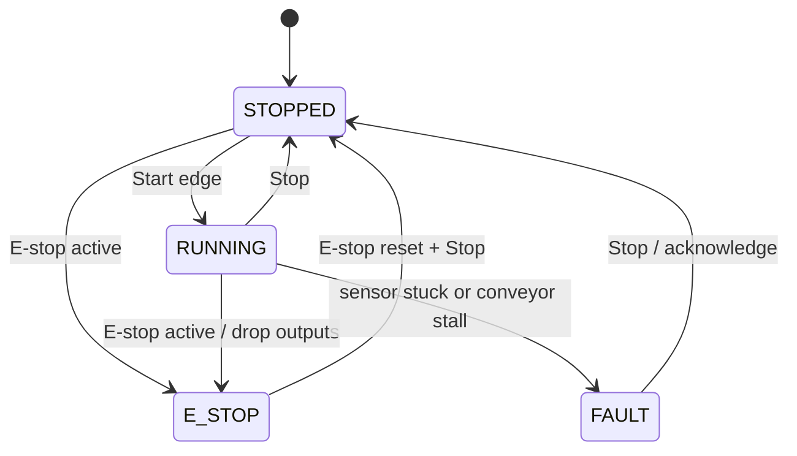

# Sorter Lab：智能分拣线数字孪生实验室

[English](README.md) · 中文

Sorter Lab 是一个可复现的 PLC 控制输送分拣线仿真项目，面向自动化、电气、测控及相关专业的课程设计、控制逻辑练习和作品集展示。系统把传感器、PLC 扫描周期、输送带、拨杆、安全联锁和故障注入放进同一个离散时间模型，并提供浏览器看板和命令行实验。

> 本项目仅用于教学和仿真，不是经过安全认证的控制器或数字孪生产品。请勿连接真实设备或用于安全关键控制。

## 快速开始

```console
git clone https://github.com/YOUR-USERNAME/sorter-lab.git
cd sorter-lab
python -m venv .venv
# Windows：.venv\Scripts\activate
# macOS/Linux：source .venv/bin/activate
python -m pip install -e .
sorter-lab web
```

浏览器打开 [http://127.0.0.1:8765](http://127.0.0.1:8765)，点击 Start 启动。可以注入光电传感器常开、输送带堵转和拨杆失效，观察 I/O、报警、产品流向和 KPI。服务默认只监听本机。

```console
sorter-lab simulate --seconds 60 --seed 7
sorter-lab simulate --seconds 60 --seed 7 --fault diverter_failure --fault-at 20
python -m unittest discover -s tests -v
```

运行时仅依赖 Python 3.11 及以上版本的标准库。

## 项目体现的自动化能力

| 课程/工程能力 | 项目实现 |
|---|---|
| PLC 控制 | 100 ms 扫描周期、输入采样、状态机、输出刷新 |
| 传感器与执行器 | 入口/分拣/出口光电传感器，输送电机和气动拨杆 |
| 安全控制思维 | E-stop 最高优先级、输出切断、人工复位、故障报警 |
| 过程控制与时序 | 物料位置、皮带速度、传感器到拨杆的触发窗口 |
| 故障诊断 | 传感器常开、皮带堵转、拨杆失效和误分拣统计 |
| 工程软件 | REST API、可视化 HMI、可重复 CLI、单元测试和 CI |

控制逻辑与被控对象分层：控制器接收输入快照、更新状态和输出；仿真器负责物料运动、传感器反馈与分拣结果。固定时间步长和随机种子让每次实验可以复现。

## 控制流程



## 仿真参数与 I/O

| 项目 | 当前值 |
|---|---:|
| PLC 扫描周期 | 100 ms |
| 输送带速度 | 0.5 m/s |
| 输送线长度 | 3 m |
| 上料间隔 | 2.5 s（仅运行时上料） |
| 产品策略 | A 类拨入 A 料箱，B 类直行进入 B 料箱 |

| 信号 | 方向 | 用途 |
|---|---|---|
| `start` / `stop` | 输入 | 启停按钮命令 |
| `emergency_stop` | 输入 | 急停，优先级最高且锁存 |
| `entry_sensor` / `sort_sensor` / `exit_sensor` | 输入 | 入口、分拣点和出口检测 |
| `conveyor_motor` | 输出 | 输送带运行命令 |
| `diverter` | 输出 | A 类产品定时拨杆命令 |
| `alarm` | 输出 | 急停或控制故障报警 |

## API

| 方法 | 路径 | 说明 |
|---|---|---|
| `GET` | `/` | 实时看板 |
| `GET` | `/api/state` | 当前状态快照 |
| `GET` | `/api/tick` | 推进 5 个 PLC 扫描周期 |
| `POST` | `/api/action` | 启停、急停复位或注入/清除故障 |
| `POST` | `/api/reset` | 重置仿真，可指定随机种子 |

完整架构、接口字段和贡献规范见[英文说明](README.md)与 [CONTRIBUTING.md](CONTRIBUTING.md)。欢迎提交 Issue 和 Pull Request；控制逻辑变更请附可复现的场景测试。
